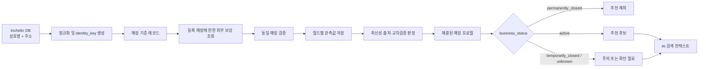

# Inchelin Guide 하이브리드 데이터 구조

## 1. 설계 목표

이 구조는 기존 Inchelin DB의 `상호명 + 주소`를 매장의 기준 식별 정보로 유지하고, DB에 없는 속성만 외부 웹 근거로 보강한다. 외부 정보는 값만 저장하지 않고 출처, 확인 날짜, 신뢰도와 충돌 상태를 함께 보존한다.

현재 프로젝트에는 실제 Inchelin DB/API 또는 외부 수집기가 연결되어 있지 않다. 이 문서는 연결 시 사용할 데이터 계약과 판정 규칙이며, 연결 전에는 실제 매장 정보를 생성하지 않는 안전 모드를 유지한다.

## 2. 핵심 흐름



## 3. 매장 식별

`identity_key = SHA-256(normalized_name + "|" + normalized_address)`를 사용한다.

- `normalized_name`: Unicode NFKC 적용, 대소문자·연속 공백·일반 문장부호 정리
- `normalized_address`: 도로명/지번 표준화 결과를 사용하고 건물의 핵심 번호는 보존
- Inchelin DB의 상호명과 주소는 기준값이므로 웹 정보가 이를 덮어쓰지 않음
- 웹의 상호명 또는 주소가 다르면 자동 병합하지 않고 `match_review` 대상으로 저장
- 유사도 검색은 후보 생성에만 사용하고, 최종 병합은 정확 주소 일치 또는 검토 승인 필요

## 4. 데이터 계층

### 기준 계층

`places`에는 Inchelin DB에서 받은 상호명, 주소와 식별키를 저장한다. 매장 상태는 조회 성능을 위해 최신 해결값을 함께 보관한다.

### 증거 계층

`sources`는 출처 자체를, `field_observations`는 특정 출처에서 확인한 개별 필드 값을 저장한다. 관측값은 덮어쓰지 않고 이력으로 누적한다.

### 해결 계층

`resolved_facts`는 여러 관측값을 비교한 최종 사용 가능 값을 저장한다. 확정할 수 없으면 값을 억지로 선택하지 않고 `needs_review` 또는 `conflict`로 유지한다.

### AI 조회 계층

AI에는 전체 원본 테이블 대신 `ai_place_profile` 투영 데이터를 전달한다. 각 필드는 값과 함께 `origin`, `checked_at`, `source_url`, `resolution_status`를 포함한다.

## 5. 외부 출처 우선순위

| 순위 | 출처 | `source_rank` |
|---|---|---:|
| 1 | 공식 홈페이지·공식 SNS | 1 |
| 2 | 지도 서비스 최신 매장 정보 | 2 |
| 3 | 예약·배달 플랫폼 | 3 |
| 4 | 최근 리뷰·블로그 | 4 |

Inchelin DB는 상호명과 주소의 기준 출처이며 `source_rank = 0`으로 별도 취급한다. 웹 출처가 기준 상호명·주소를 변경할 수는 없다.

## 6. 필드별 관측값

보강 대상은 `business_status`, `opening_hours`, `representative_menu`, `menu_price`, `parking`, `phone`, `official_links`, `reservation`이다.

모든 관측값은 다음 메타데이터를 가진다.

- `source_id`, `source_rank`, `source_url`
- `observed_at`: 출처가 정보를 게시·표시한 시각
- `retrieved_at`: 수집기가 확인한 시각
- `confidence`: 0~1 범위의 내부 신뢰도
- `verification_state`: `verified`, `needs_review`, `conflict`, `stale`, `rejected`
- `raw_value`와 정규화된 `value_json`

## 7. 충돌 해결

1. 공식 출처의 명시적 정보가 있으면 우선한다.
2. 같은 우선순위에서는 `observed_at`, 없으면 `retrieved_at`이 최신인 값을 우선한다.
3. 서로 다른 출처 두 곳 이상이 같은 값을 독립적으로 확인하면 신뢰도를 높인다.
4. 높은 우선순위 정보라도 오래되었거나 최신 하위 출처와 충돌하면 자동 확정하지 않는다.
5. 메뉴 가격, 주차, 예약처럼 변동 가능한 정보가 충돌하면 `needs_review` 또는 `conflict`로 유지한다.
6. AI는 `confirmed` 값만 사실형 문장에 사용한다. `needs_review` 값은 “최신 확인이 필요해요”라고 표현하고 필터에는 사용하지 않는다.

필드별 유효기간은 운영 데이터로 설정하며 코드에 고정하지 않는다. 예를 들어 영업 상태와 영업시간은 짧게, 전화번호와 공식 URL은 상대적으로 길게 설정할 수 있다.

## 8. 매장 상태

```text
active
temporarily_closed
permanently_closed
unknown
```

- `permanently_closed`: 추천 후보에서 무조건 제외
- `temporarily_closed`: 현재 방문 추천에서는 제외하고 재개 확인 작업 대상으로 유지
- `active`: 정상 추천 후보
- `unknown`: 확정 추천보다 후순위이며 사용자에게 확인 필요 상태를 숨기지 않음

폐업 판정은 공식 출처 또는 신뢰 가능한 복수 출처가 필요하다. 단일 블로그나 오래된 리뷰만으로 `permanently_closed`를 확정하지 않는다.

## 9. AI 사용 규칙

- 상호명과 주소는 항상 `inchelin_core`에서 읽는다.
- 웹 보강값은 `resolution_status = confirmed`이고 유효기간 내인 필드만 사용한다.
- 실제 매장에 관한 문장에는 내부적으로 사용한 `source_id` 목록을 추적한다.
- 사용자에게는 기준 정보와 웹 정보를 한 문장으로 자연스럽게 통합하되, 웹 정보가 불확실하면 “확인 필요”를 명시한다.
- 근거가 없는 필드는 누락으로 처리하며 모델의 일반 지식으로 채우지 않는다.
- 추천 쿼리는 먼저 `business_status`를 검사하고 `permanently_closed`를 제외한다.

## 10. 수집 및 갱신 파이프라인

1. Inchelin DB 스냅샷을 읽고 `identity_key`로 매장을 upsert한다.
2. Inchelin DB에 등록된 매장에 한해서만 상호명과 주소로 외부 보강 후보를 조회한다. 외부 조회 결과를 신규 추천 후보로 추가하지 않는다.
3. 주소 일치, 도메인 소유 관계, 전화번호 등으로 동일 매장 여부를 검증한다.
4. 출처 원문과 필드별 관측값을 변경 불가능한 이력으로 저장한다.
5. 출처 우선순위, 최신성, 교차 확인을 기준으로 해결값을 계산한다.
6. `business_status`를 먼저 갱신하고 폐업 매장을 검색 인덱스에서 제거한다.
7. 해결된 필드만 AI 조회용 프로필과 검색 인덱스에 반영한다.
8. 만료된 필드는 재수집 큐에 넣고, 충돌 필드는 검토 큐로 보낸다.

## 11. 구현 순서

1. Inchelin DB의 실제 테이블 또는 API 스키마 확정
2. `identity_key` 생성 및 중복 매장 정리
3. 공식 홈페이지/SNS 수집기부터 연결
4. 지도·예약·배달 공급자별 이용약관과 API 사용 범위 확인
5. 필드별 유효기간과 신뢰도 정책 확정
6. 백필 작업 후 샘플 매장으로 충돌 해결 검증
7. AI 조회 API에 `ai_place_profile`만 노출

## 12. 런타임 강제 정책

Worker는 `INCHELIN_DB_API_URL`의 등록 매장 API를 먼저 호출한다. 이 조회에 없는 매장은 외부 보강 API를 호출하지 않고 미등록 안내를 반환한다.

- `INCHELIN_DB_API_URL`: 등록 매장 검색 API의 HTTPS 기준 URL
- `INCHELIN_DB_API_TOKEN`: 등록 매장 API 인증 토큰
- `INCHELIN_ENRICHMENT_API_URL`: 등록 매장 전용 보강 API의 HTTPS 기준 URL
- `INCHELIN_ENRICHMENT_API_TOKEN`: 보강 API 인증 토큰

보강 API는 `place_id`, 기준 상호명, 기준 주소와 지점을 입력받는다. 응답의 `identity_confirmed`가 참이고, 응답 상호명과 주소가 기준값과 정규화 후 정확히 일치할 때만 `confirmed` 사실을 AI 컨텍스트에 넣는다. 연결 오류가 나면 임의 추천으로 대체하지 않고 안전하게 실패한다.

